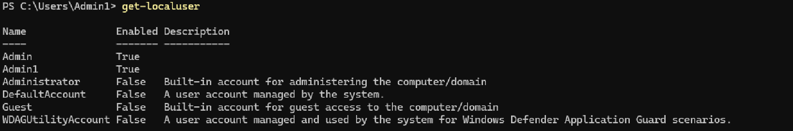

<h1>Investigation Timeline</h1>

<h2>Purpose: This timeline organizes relevant observations, findings, and events collected during the Windows host investigation. It records timestamps, supporting evidence, and interpretations to practice reconstructing activity on a system.</h2>

------------------

<h3>Timeline:</h3>

Event #1: Initial system investigation began
    
   Date and Time: Time not recorded
    
   Evidence: Investigation notes
    
   Interpretation: Established the starting point for the investigation

Event #2: Local accounts enumerated
 
   Date and Time: Time not recorded
    
   Evidence: Screenshot: 
    
   Interpretation: Recorded the existing accounts and their status

Event #3: Process and service baseline collected
 
   Date and Time: Time not recorded
    
   Evidence: Screenshot: Process investigation, investigation-notes
    
   Interpretation: Collected the number of processes and services running and investigated two processes deeper, uncovering their full path and purpose. 

Event #4: Network configurations and TCP connections examined
 
   Date and Time: Time not recorded
    
   Evidence: Screenshot: Network configurations and connections, investigation-notes
    
   Interpretation: Recorded the network configurations and connections observed

Event #5: Selected Windows event logs examined further
 
   Date and Time: 10/21/2026 6:59:09 PM
    
   Evidence: Screenshot: Event log investigation-Event viewer-changed user account
    
   Interpretation: reviewed available event evidence on a User account change of ID 4738

Event #6: LabTestUser created
 
   Date and Time: 10/22/2026 3:07:54 AM
    
   Evidence: Screenshot: Simulated event - creating user
    
   Interpretation: Confirmed the creation of the controlled account via PowerShell

Event #7: Account-creation event observed
 
   Date and Time: 10/22/2026 3:07:54 AM
    
   Evidence: Screenshot: Evidence of new user - Event viewer
    
   Interpretation: Corroborated the action using Windows security logs
   
   
   
